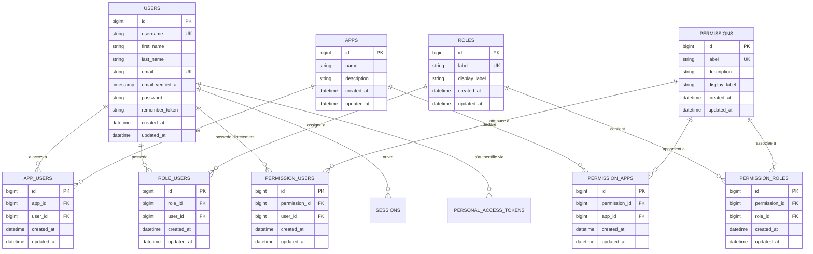
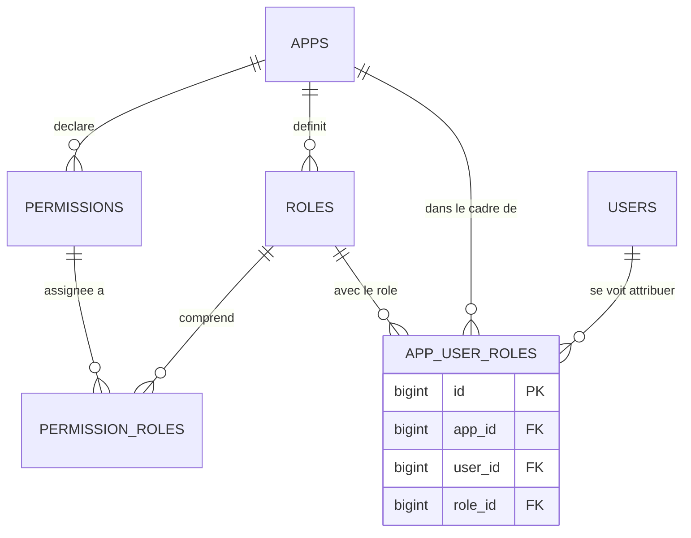

# Audit Architectural & Modélisation Relationnelle de la Base de Données — Authentication API

> **Projet :** API d'Authentification & IAM Centralisé (`authentication-api`)  
> **Chemin cible dans le projet :** `backends/authentication-api/database/AUDIT_BASE_DE_DONNEES.md`  
> **Date de l'audit :** Novembre 2026  
> **Auteur :** Lead Database & SaaS Architect  
> **Statut du document :** Rapport de Référence Architectural  
> **SGBD Cible :** MySQL 8.0+ / MariaDB 10.5+

---

## 1. Vue d'Ensemble & Domaine Métier

Le projet **authentication-api** est le cœur d'identification et d'autorisation (IAM / RBAC) de l'écosystème d'entreprise `company-management`. Il a pour vocation de gérer :
1. **L'identité numérique centrale :** Comptes utilisateurs uniques (`users`), identifiants de connexion (`username`, `email`), vérification et hachage de mots de passe.
2. **Le catalogue d'applications :** Déclaration des microservices et applications satellites de l'entreprise (`apps`) telles que `employe-api`, `webmail-api`, intranet, etc.
3. **Le contrôle d'accès basé sur les rôles (RBAC) :** Rôles transverses ou applicatifs (`roles`), permissions granulaires (`permissions`), habilitations directes (`permission_users`) ou déléguées (`permission_roles`).
4. **L'éligibilité applicative :** Accès accordés aux utilisateurs sur les applications spécifiques (`app_users`) et périmètre des permissions par application (`permission_apps`).
5. **L'authentification API par jetons :** Émission et révocation des tokens via Laravel Sanctum (`personal_access_tokens`).

---

## 2. Cartographie & Diagramme Relationnel (Entity-Relationship Diagram)



---

## 3. Points Forts de la Modélisation Actuelle

1. **Intégrité référentielle stricte avec cascades :** L'ensemble des tables pivots de liaisons (`role_users`, `permission_users`, `permission_roles`, `permission_apps`, `app_users`) intègrent des clés étrangères avec clauses de suppression en cascade (`cascadeOnDelete()` ou `onDelete('cascade')`), empêchant l'apparition d'enregistrements orphelins lors de la suppression d'un utilisateur, d'un rôle ou d'une permission.
2. **Contraintes d'unicité composites protectrices :** Toutes les tables d'association interdisent formellement les doublons logiques au niveau du moteur de base de données via des clés uniques composites :
   - `UNIQUE(role_id, user_id)`
   - `UNIQUE(permission_id, user_id)`
   - `UNIQUE(permission_id, role_id)`
   - `UNIQUE(permission_id, app_id)`
   - `UNIQUE(app_id, user_id)`
3. **Double niveau d'habilitation RBAC & Droit direct :** L'architecture autorise à la fois une attribution classique via profil/rôle (`permission_roles`) et des surcharges fines par utilisateur (`permission_users`), offrant une excellente adaptabilité opérationnelle.
4. **Normalisation de l'identité :** La séparation stricte de l'authentifiant technique (`username` UNIQUE), du canal de communication (`email` UNIQUE) et des données civiles (`first_name`, `last_name`) respecte rigoureusement la Première et Deuxième Forme Normale.

---

## 4. Anomalies, Risques et Points de Friction Identifiés

### Synthèse des Anomalies

| ID | Intitulé | Criticité | Table(s) Impactée(s) | Impact / Risque |
| :--- | :--- | :---: | :--- | :--- |
| **AUTH-01** | Absence de scope applicatif (`app_id`) sur les rôles | **HAUTE** | `roles`, `role_users` | Élévation involontaire de privilèges transverses à toutes les applications |
| **AUTH-02** | Découplage incohérent entre `permission_apps` et `permission_roles` | **HAUTE** | `permission_apps`, `permission_roles` | Attribution de permissions appartenant à des applications différentes au sein d'un même rôle |
| **AUTH-03** | Surconsommation d'index par sur-utilisation de surrogate keys (`id`) | **MOYENNE** | Tables pivots | Clé primaire artificielle + index composite unique = redondance de structure B-Tree |
| **AUTH-04** | Indexation asymétrique pour la recherche des habilitations d'un utilisateur | **MOYENNE** | `role_users`, `permission_users` | Requêtes fréquentes `WHERE user_id = ?` non couvertes par le préfixe de l'index composite |
| **AUTH-05** | Absence de traçabilité des accès et audit des autorisations | **MOYENNE** | Schéma global | Non-conformité aux exigences de sécurité IAM / RGPD (qui a accordé quel droit, et quand) |
| **AUTH-06** | Hétérogénéité des migrations (classes anonymes vs classes nommées) | **FAIBLE** | Migrations | Inconsistance de style lors des déploiements et maintenance |

---

### Analyse Détaillée des Anomalies

#### [AUTH-01] Rupture du modèle Multi-App : Absence de portée applicative sur les rôles (Criticité : HAUTE)
- **Constat :** Les tables `apps` et `app_users` permettent d'autoriser un utilisateur sur une application donnée (ex: `employe-api`). Parallèlement, `permission_apps` lie les permissions à des applications spécifiques.  
  **Cependant**, la table `roles` et la table d'association `role_users` ne possèdent aucune colonne `app_id` !
- **Risque d'exploitation / Faille de sécurité :**  
  Si un utilisateur reçoit le rôle `"Admin"` pour l'application `webmail-api`, ce rôle lui est assigné globalement au niveau de la table `role_users (role_id, user_id)`. Lorsqu'il tente d'interagir avec `employe-api`, le moteur d'autorisation détectera le rôle `"Admin"`. Il y a une **élévation de privilèges inter-domaines** si les applications ne vérifient pas manuellement l'intersection des permissions.
- **Correction recommandée :**  
  Faire évoluer le RBAC vers un schéma contextualisé : soit en ajoutant `app_id` dans `roles` (les rôles sont propres à une application), soit en intégrant `app_id` dans la table d'assignation `app_user_roles (app_id, user_id, role_id)`.

#### [AUTH-02] Incohérence Relationnelle : Permissions applicatives associées à des rôles agnostiques (Criticité : HAUTE)
- **Constat :** La permission $P_1$ appartient à l'application $A_1$ (via `permission_apps`). La permission $P_2$ appartient à l'application $A_2$. Rien n'interdit au niveau de la base de données d'associer $P_1$ et $P_2$ au même rôle $R$.
- **Risque :** Risque de mélange de responsabilités, fuite de droits transverses et incapacité de purger automatiquement les permissions lors de la désactivation d'une application pour un utilisateur.
- **Correction :** Garantir la cohérence via une clé étrangère composite liant `(permission_id, app_id)` au rôle ou lier formellement chaque rôle à une application parent (`roles.app_id`).

#### [AUTH-03] Surcoût des surrogate keys (`id`) sur les tables pivots (Criticité : MOYENNE)
- **Constat :** Chaque table pivot (`role_users`, `permission_users`, etc.) possède une colonne `id` auto-incrémentée (clé primaire) ET une contrainte d'unicité composite `unique(['role_id', 'user_id'])`.
- **Analyse :** Ce pattern est souvent employé pour faciliter les CRUD génériques basés sur des contrats d'interface (`IModel`). Toutefois, d'un point de vue purement relationnel et performance :
  - La table stocke deux index complets sur les mêmes lignes.
  - La clé primaire naturelle est par essence `PRIMARY KEY (role_id, user_id)`.
  - Sur de fortes volumétries de tokens et d'autorisations en cache distribué, cela augmente inutilement la taille des fichiers de tablespaces InnoDB (`.ibd`).

#### [AUTH-04] Indexation asymétrique pour `WHERE user_id = ?` (Criticité : MOYENNE)
- **Constat :** Dans `role_users`, l'index unique est défini par `$table->unique(['role_id', 'user_id'])`.
- **Problème :** En SQL, un index composite sur `(A, B)` ne peut pas être exploité par un prédicat filtrant uniquement sur `B` (`WHERE B = ?`). La requête la plus courante du système d'authentification lors de la connexion est :  
  `SELECT role_id FROM role_users WHERE user_id = ?`
  Bien qu'InnoDB crée souvent un index implicite lors de la déclaration de la contrainte étrangère, la bonne pratique est de déclarer explicitement l'index sur `user_id` ou d'inverser l'ordre de la clé composite en `unique(['user_id', 'role_id'])` car on recherche 95% du temps les rôles d'un utilisateur donné.

---

## 5. Recommandations Architecturales & Évolution 3NF

### Architecture Cible RBAC Multi-Tenant / Multi-Application

Pour que le système d'authentification centralisé puisse alimenter en toute sécurité des applications hétérogènes (`petite-lune`, `employe-api`, `webmail-api`), deux architectures 3NF sont envisageables :

#### Option Recommandée : Rôles Scopeés par Application
Rattacher chaque rôle à une application cible (ou rôle global système si `app_id IS NULL`) :
1. `roles` dispose d'un `app_id` nullable (`foreignId('app_id')->nullable()->constrained('apps')->cascadeOnDelete()`).
2. Contrainte unique sur le label par application : `UNIQUE(app_id, label)`.
3. Une permission $P$ ne peut être attribuée à un rôle $R$ que si $P.app\_id = R.app\_id$.



---

## 6. Proposition Concrète de Migration de Refactoring

Fichier recommandé : `database/migrations/2026_11_07_000001_harden_auth_indexes_and_roles_scope.php`

```php
<?php

use Illuminate\Database\Migrations\Migration;
use Illuminate\Database\Schema\Blueprint;
use Illuminate\Support\Facades\Schema;

return new class extends Migration
{
    /**
     * Renforce l'indexation, le scope applicatif et l'auditabilité du système IAM.
     */
    public function up(): void
    {
        // 1. Optimisation des index de recherche par utilisateur
        Schema::table('role_users', function (Blueprint $table) {
            $table->index('user_id', 'idx_role_users_user_lookup');
        });

        Schema::table('permission_users', function (Blueprint $table) {
            $table->index('user_id', 'idx_permission_users_user_lookup');
        });

        Schema::table('app_users', function (Blueprint $table) {
            $table->index('user_id', 'idx_app_users_user_lookup');
        });

        // 2. Rattachement optionnel d'un rôle à une application pour le cloisonnement
        Schema::table('roles', function (Blueprint $table) {
            $table->foreignId('app_id')
                ->nullable()
                ->after('id')
                ->constrained('apps')
                ->cascadeOnDelete();
        });

        // 3. Table de traçabilité et d'audit des habilitations
        Schema::create('auth_audit_logs', function (Blueprint $table) {
            $table->id();
            $table->foreignId('operator_id')->nullable()->constrained('users')->nullOnDelete();
            $table->foreignId('target_user_id')->constrained('users')->cascadeOnDelete();
            $table->string('action'); // role_assigned, role_revoked, permission_granted...
            $table->string('entity_type'); // Role, Permission
            $table->unsignedBigInteger('entity_id');
            $table->string('ip_address', 45)->nullable();
            $table->timestamp('created_at')->useCurrent();

            $table->index(['target_user_id', 'created_at']);
        });
    }

    /**
     * Annule les modifications.
     */
    public function down(): void
    {
        Schema::dropIfExists('auth_audit_logs');

        Schema::table('roles', function (Blueprint $table) {
            $table->dropForeign(['app_id']);
            $table->dropColumn('app_id');
        });

        Schema::table('app_users', function (Blueprint $table) {
            $table->dropIndex('idx_app_users_user_lookup');
        });

        Schema::table('permission_users', function (Blueprint $table) {
            $table->dropIndex('idx_permission_users_user_lookup');
        });

        Schema::table('role_users', function (Blueprint $table) {
            $table->dropIndex('idx_role_users_user_lookup');
        });
    }
};
```
